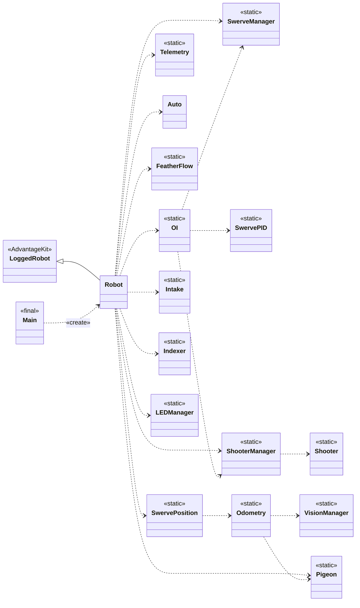
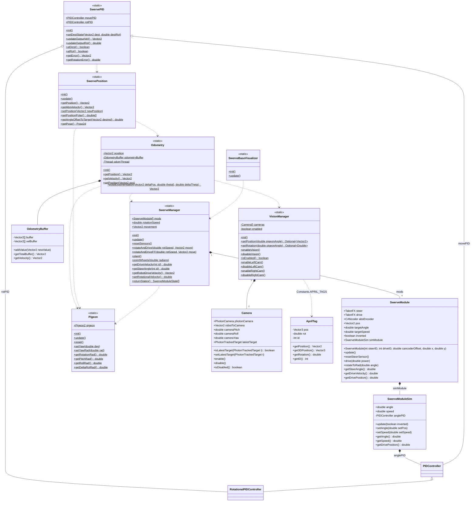
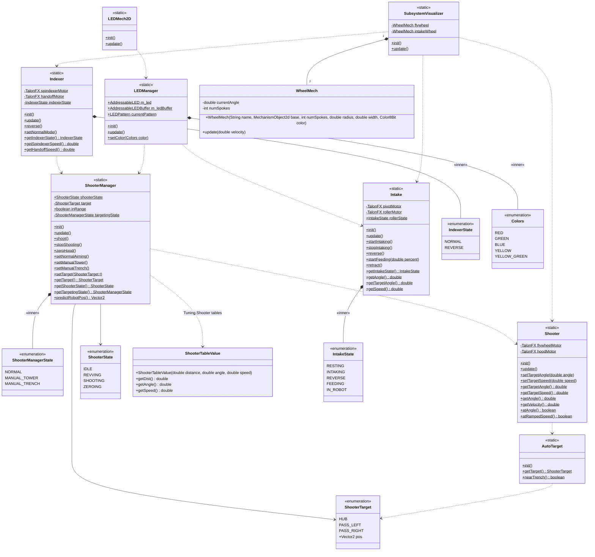
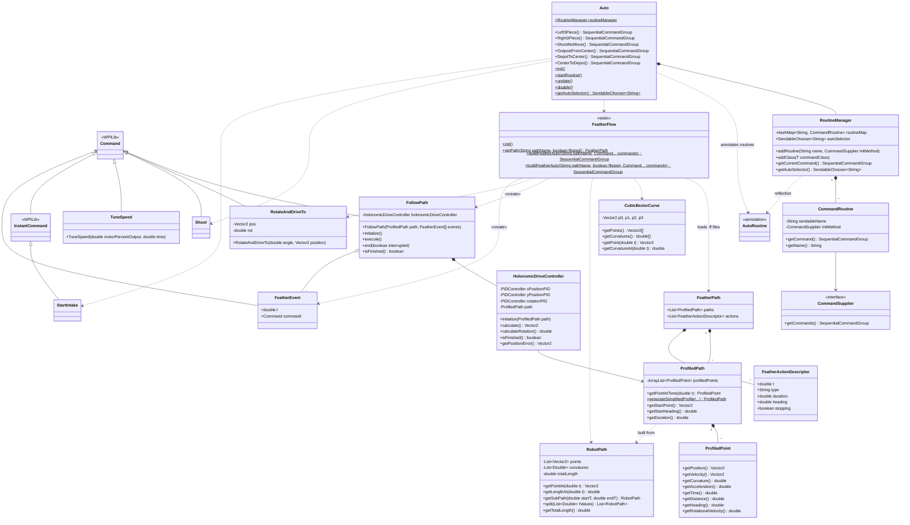

# 2026Rebuilt class diagrams

The project has 55 types (classes, enums, an interface and an annotation), so the
diagrams are split by area. Most subsystems are all-static "manager" classes with
`init()` / `update()` methods instead of WPILib `Subsystem` objects, so most of
the arrows are «use» dependencies, not fields. Static members end with `$`.

1. [Overview](#1-overview)
2. [Swerve drive and localization](#2-swerve-drive-and-localization)
3. [Scoring subsystems](#3-scoring-subsystems)
4. [Autonomous and trajectories](#4-autonomous-and-trajectories)
5. [Utilities and configuration](#5-utilities-and-configuration)

## 1. Overview

`Robot` drives the loop: each periodic call runs `update()` on the managers below.

## 2. Swerve drive and localization

## 3. Scoring subsystems

## 4. Autonomous and trajectories

`HolonomicDriveController` uses WPILib's `edu.wpi.first.math.controller.PIDController`,
not the project's own `frc.robot.utils.PIDController`.

## 5. Utilities and configuration

```mermaid
classDiagram
    direction TB
    class Sendable
    <<interface>> Sendable
    class PIDController {
        -int instances$
        #double dest
        +double kP, kI, kD
        +double deadband
        +double velDeadband
        +double max
        +PIDController(double p, double i, double d, double deadband, double velDeadband, double max)
        +setDest(double dest)
        +getDest() double
        +updateOutput(double pos) double
        +atSetpoint() boolean
        +isActive() boolean
        +getError() double
        +initSendable(SendableBuilder builder)
    }
    class RotationalPIDController {
        +setDest(double dest)
        +updateOutput(double pos) double
    }
    class TrapezoidalProfile {
        -double maxVelocity
        -double maxAcceleration
        -double maxDeceleration
        +TrapezoidalProfile(TrapezoidalPreset preset)
        +generateProfile(double totalDistance)
        +getVelocity(double distance) double
        +printProfile()
    }
    class TrapezoidalPreset {
        <<enumeration>>
        MOVE_PRECISE
        MOVE_FAST
        ROT_PRECISE
    }
    class Vector2 {
        +double x
        +double y
        +fromPolar(double theta, double r)$ Vector2
        +add(Vector2 v) Vector2
        +sub(Vector2 v) Vector2
        +mul(double s) Vector2
        +div(double s) Vector2
        +mag() double
        +norm() Vector2
        +rotate(double angle) Vector2
        +dot(Vector2 v) double
        +atan2() double
        +dist(Vector2 p) double
        +copy() Vector2
        +convertToFieldCoords() Vector2
    }
    class Vector3 {
        +add(Vector3 u, Vector3 v)$ Vector3
        +sub(Vector3 u, Vector3 v)$ Vector3
        +cross(Vector3 u, Vector3 v)$ Vector3
        +dot(Vector3 u, Vector3 v)$ double
        +scale(double s) Vector3
        +mag() double
        +unitVector() Vector3
        +getX() double
        +getY() double
        +getZ() double
        +getPitch() double
    }
    class RMath {
        <<static>>
        +targetAngleAbsolute(double cur, double target, double range)$ double
        +smoothJoystick1(double val)$ double
        +smoothJoystick2(Vector2 dir)$ Vector2
        +clamp(double in, double min, double max)$ double
        +interpolate(double a, double b, double t)$ double
        +interpolateRotationRad(double a, double b, double t)$ double
        +deadband(double value, double center, double deadband)$ double
        +modulo(double a, double b)$ double
    }
    class RTime {
        <<static>>
        +init()$
        +update()$
        +updateAbsolute()$
        +now()$ double
        +deltaTime()$ double
        +absolute_frame()$ long
        +createTimestamp()$ String
    }
    class Constants {
        <<static>>
        +AprilTag[] APRIL_TAGS$
    }
    class Constants_Swerve["Constants.Swerve"]
    class Constants_Shooter["Constants.Shooter"]
    class Constants_Intake["Constants.Intake"]
    class Constants_Indexer["Constants.Indexer"]
    class Constants_Traj["Constants.TrajectoryConstants"]
    class Tuning
    <<static>> Tuning
    class Tuning_OI["Tuning.OI"]
    class Tuning_Shooter["Tuning.Shooter"] {
        +ShooterTableValue[] SHOOTER_TABLE_HUB$
    }
    class Tuning_Indexer["Tuning.Indexer"]
    class Tuning_Intake["Tuning.Intake"]
    class LogitechF310 {
        <<static>>
        +int AXIS_LEFT_X$
        +int AXIS_LEFT_Y$
        +int AXIS_RIGHT_X$
        +int BUTTON_A$
        ...
    }
    class OI {
        <<static>>
        -Joystick driverStick$
        -Joystick operatorStick$
        +boolean manualAim$
        +init()$
        +update()$
    }
    class Telemetry {
        <<static>>
        +Mechanism2d subsystemViewSide$
        +Mechanism2d subsystemViewTop$
        +Mechanism2d swerveView$
        +init()$
        +update()$
    }

    Sendable <|.. PIDController
    PIDController <|-- RotationalPIDController
    TrapezoidalProfile *-- TrapezoidalPreset : «inner»
    RMath ..> Vector2
    Constants *-- Constants_Swerve : «inner»
    Constants *-- Constants_Shooter : «inner»
    Constants *-- Constants_Intake : «inner»
    Constants *-- Constants_Indexer : «inner»
    Constants *-- Constants_Traj : «inner»
    Tuning *-- Tuning_OI : «inner»
    Tuning *-- Tuning_Shooter : «inner»
    Tuning *-- Tuning_Indexer : «inner»
    Tuning *-- Tuning_Intake : «inner»
    OI ..> LogitechF310
```

`Vector2`, `RMath`, `RTime`, `Constants` and `Tuning` are used almost everywhere, so
the other diagrams leave those arrows out.
